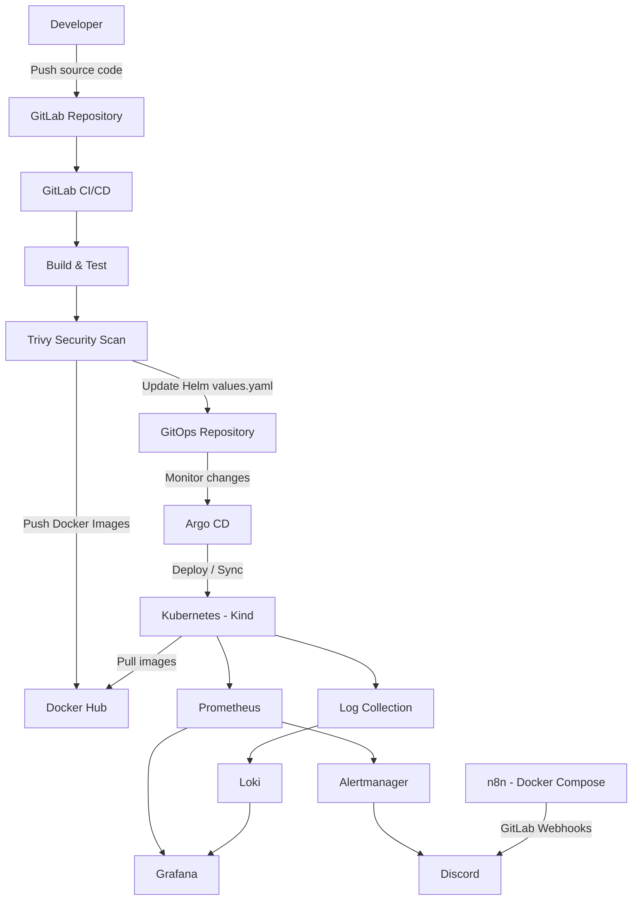

# 🚀 End-to-End DevOps & GitOps Project

An end-to-end DevOps project demonstrating the automation, deployment, orchestration, and monitoring of a MERN application using modern DevOps and cloud-native technologies.

The project implements a complete CI/CD and GitOps workflow, from source code integration and Docker image building to automated Kubernetes deployments, monitoring, logging, and alerting.

## 📌 Project Overview

The objective of this project is to build and manage a containerized MERN application using DevOps practices, with a focus on automation, infrastructure management, continuous delivery, and observability.

The application is deployed on a local Kubernetes cluster using Kind, while GitLab CI/CD automates the build and delivery process and Argo CD manages application deployments through GitOps.

## 🏗️ Architecture

The architecture follows a GitOps-based deployment workflow:

## 🛠️ Technologies & Tools

| Category | Technologies |
|---|---|
| Application | MongoDB, Express.js, React.js, Node.js |
| Containerization | Docker, Docker Compose |
| CI/CD | GitLab CI/CD |
| Container Registry | Docker Hub |
| Security Scanning | Trivy |
| Infrastructure as Code | Terraform |
| Orchestration | Kubernetes (Kind) |
| Package Management | Helm |
| GitOps | Argo CD |
| Networking | NGINX Ingress Controller, MetalLB |
| Monitoring | Prometheus, Grafana |
| Logging | Loki |
| Alerting | Alertmanager, Discord |
| Workflow Automation | n8n |
| Environment | WSL2, Debian |

## ⚙️ Implementation

### 1. Application Containerization
- Containerized the MERN application using Docker.
- Created Docker images for the frontend and backend.
- Used Docker Compose to run the application and its dependencies locally.

### 2. CI/CD Pipeline – GitLab
Implemented an automated GitLab CI/CD pipeline to:
- Validate and test application changes.
- Build Docker images for the frontend and backend.
- Scan container images for vulnerabilities using Trivy.
- Push validated images to Docker Hub.
- Update the image tags in the GitOps repository.

### 3. Infrastructure as Code – Terraform
- Used Terraform to practice Infrastructure as Code principles.
- Organized infrastructure configuration to support reproducible and automated infrastructure management.

### 4. Kubernetes Deployment
Deployed the application on a local Kubernetes cluster using Kind.

Implemented:
- Kubernetes Deployments and Services.
- ConfigMaps for application configuration.
- Persistent Volumes and Persistent Volume Claims.
- Readiness and liveness probes.
- NGINX Ingress Controller for external application access.
- MetalLB for LoadBalancer service exposure.
- Horizontal Pod Autoscaler (HPA) for automatic scaling.

**HPA configuration:**
- Minimum replicas: 2
- Maximum replicas: 5
- Target CPU utilization: 60%

### 5. GitOps – Argo CD & Helm
Implemented GitOps principles using Argo CD and Helm.

The deployment workflow:
1. A developer pushes changes to GitLab.
2. GitLab CI/CD builds, tests, and scans Docker images.
3. The pipeline pushes the images to Docker Hub.
4. The pipeline updates the image tag in the Helm configuration stored in Git.
5. Argo CD detects changes in the Git repository.
6. Argo CD synchronizes the desired state with the Kubernetes cluster.
7. Kubernetes deploys the updated application and pulls the required container images from Docker Hub.

### 6. Monitoring & Logging
Implemented an observability stack using Prometheus, Grafana, and Loki.

- **Prometheus:** Collects infrastructure and application metrics.
- **Grafana:** Provides dashboards for monitoring application and Kubernetes performance.
- **Loki:** Centralizes application and container logs.
- **Alertmanager:** Manages alerts generated from Prometheus rules.
- **Discord:** Receives alert notifications.

### 7. Workflow Automation – n8n
Integrated n8n as a separate Docker Compose deployment to explore operational automation.

Implemented:
- GitLab webhook integration.
- Automated pipeline notifications through Discord.
- Development of automated infrastructure reporting workflows.

## 🔄 GitOps Workflow

The project separates application source code from deployment configuration.

| Component | Responsibility |
|---|---|
| GitLab CI/CD | Automates build, testing, security scanning, and image delivery |
| Docker Hub | Stores frontend and backend container images |
| GitOps Repository | Stores Helm deployment configuration |
| Argo CD | Monitors Git and synchronizes Kubernetes resources |
| Kubernetes | Runs and manages application workloads |

**Important:** Argo CD does not build or pull Docker images. It synchronizes Kubernetes resources based on Git configuration, while Kubernetes nodes pull the required images from Docker Hub.

## 📂 Application Components

The application consists of three main components:

- **Frontend:** React.js application.
- **Backend:** Node.js and Express.js REST API.
- **Database:** MongoDB for persistent application data.

The backend communicates with MongoDB, while the frontend communicates with the backend through REST API requests.

## 🎯 Key Learning Outcomes

Through this project, I gained hands-on experience with:

- Building automated CI/CD pipelines.
- Containerizing multi-tier applications.
- Implementing GitOps workflows.
- Managing Kubernetes workloads and resources.
- Automating deployments with Helm and Argo CD.
- Applying Infrastructure as Code principles.
- Implementing container image security scanning.
- Configuring application monitoring and centralized logging.
- Managing alerts and automating operational notifications.
- Troubleshooting Kubernetes networking, storage, permissions, and deployments.

## 🚀 Future Improvements

- Integrate additional DevSecOps security checks.
- Improve automated infrastructure reporting through n8n.
- Extend monitoring with application-specific metrics.
- Implement automated deployment rollback strategies.
- Explore deployment on a cloud Kubernetes platform.

## 👨‍💻 Author

**Anass Najam**

Master's Graduate in Network Engineering | DevOps & Cloud Enthusiast

- GitHub: [@ansnjm](https://github.com/ansnjm)
- LinkedIn: https://www.linkedin.com/in/anass-najam-809937199/

---

*This project is a personal hands-on lab developed to strengthen practical skills in DevOps, GitOps, Kubernetes, Cloud, and Infrastructure Automation.*